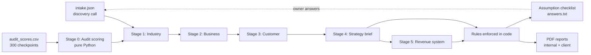
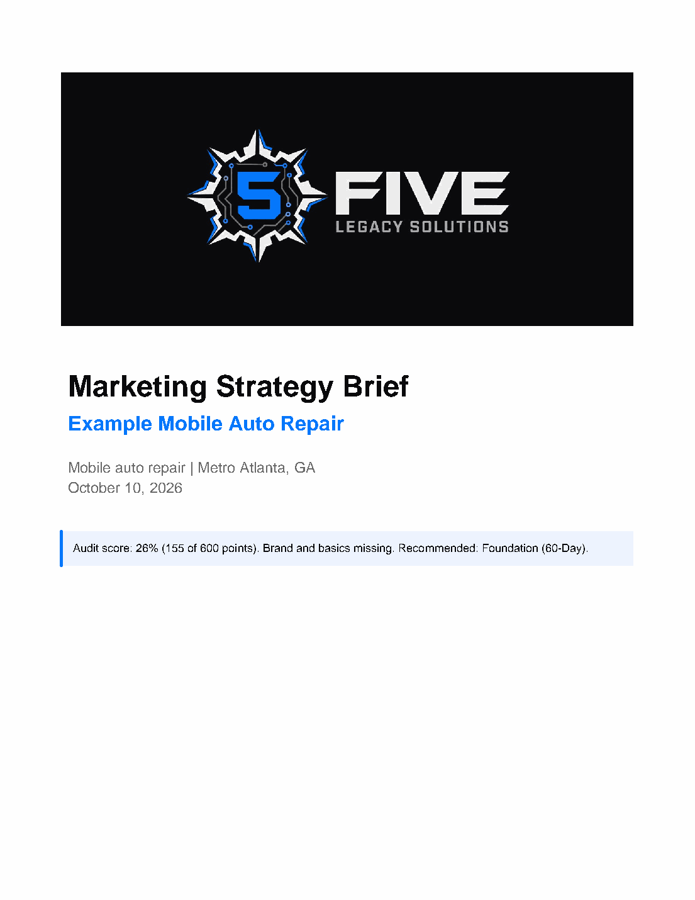
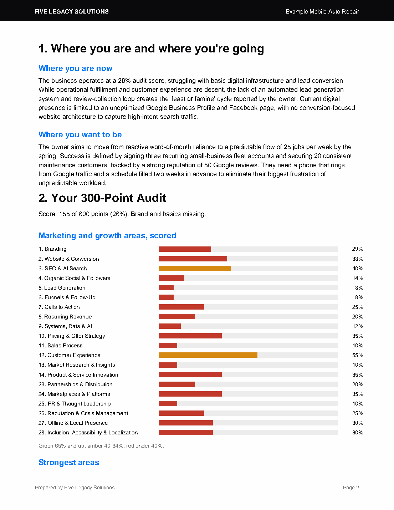
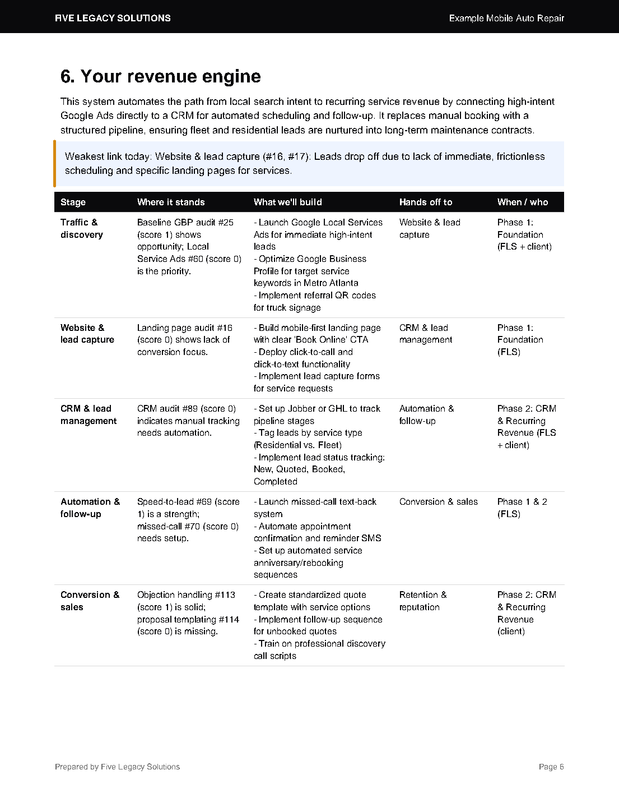

# Marketing Strategy Engine

A Python pipeline that turns a business's discovery intake and a 300-checkpoint audit into a validated, internally consistent marketing strategy, then exports it as branded PDF reports.

I built it for my consultancy to solve one problem: **large language models write fluent plans that quietly contradict themselves.** Budgets that don't add up, channels promised but never scheduled, facts the client never gave. This engine treats the model as a drafting tool and enforces the business rules in code.

> This is a showcase repository. The production code, the full audit checklist and pricing are private business IP, and no client data ever leaves the private repo. Everything shown here comes from a **fictional demo client** ("Example Mobile Auto Repair") used to test the system.

---

## What it does



1. **Audit scoring (no AI).** 300 checkpoints across 29 categories are scored *missing / weak / working / n/a*. Not-applicable items are removed and the score is rescaled, so an online store isn't penalized for lacking local listings. The score maps to a recommended engagement and flags areas to refer out (legal, finance, HR).
2. **Five AI stages.** Industry → business → customer → strategy brief → revenue system. Each stage receives the validated output of the previous ones, which is what keeps the plan consistent.
3. **Rules in code.** After every AI stage, Python re-applies the non-negotiables. It checks package scope, add-on eligibility, coverage of the four core channels (CRM, lead generation, SEO, paid ads), the fees-vs-ad-spend budget arithmetic, a single system of record, and KPI coverage.
4. **Assumption loop.** Every guess the AI makes is returned as a structured, yes/no question with the answer the plan assumes and what changes if it's wrong. Answers are written back into the intake as facts and never asked again.
5. **Reports.** ReportLab builds an internal review PDF (assumptions, benchmarks, rules) and a clean client PDF.

## Engineering highlights

| Problem | What I did |
|---|---|
| Model output drifts from the expected shape | **Pydantic v2 schemas** for every stage; responses are validated and retried once with the validation error. |
| Vendor lock-in and rate limits | **Provider-agnostic LLM layer** (OpenAI, Anthropic, Gemini) with exponential backoff on 429/5xx and fail-fast on daily quota. |
| Re-running everything is slow and costs API calls | **SHA-256 fingerprint** of the inputs; stages rebuild only when the intake or audit changes. |
| The AI flags the same thing five ways | **De-duplication** by keyword overlap (union-find), ranking by impact, and a cap on questions asked. |
| Plans that don't add up | **Budget arithmetic checked in code**; the plan is marked *fits / does not fit* against the client's real budget. |
| Secrets and client data | `.env` and real client folders are git-ignored; free-tier models are used only on fictional test data. |

## Sample run (demo client)

```text
# abridged output
$ python run.py clients/example-auto-shop
Client: Example Mobile Auto Repair
  no changes since the last run: reusing saved stages (no AI requests)
  audit: 157/600 (26%) -> Foundation (60-Day)
Core channels:
  CRM              [add-on, Phase 2] Implement a trade-specific CRM for lead tracking and rebooking.
  Lead generation  [in package, Phase 1] Focus on referral incentives and local business networking.
  SEO              [in package, Phase 1] Optimize GBP and build local service pages.
  Paid ads         [in package, Phase 1] Pause Facebook boosting; launch Google Local Services Ads.
Assumptions (merged from 10 flags): 2 questions for the client, 4 for FLS research
PDFs updated:
  review first: ..._strategy_brief_INTERNAL.pdf
  then share:   ..._strategy_brief_client.pdf
```

## Output (demo client)

| Cover | Audit summary | Revenue engine |
|---|---|---|
|  |  |  |

## Stack

Python 3.14 · Pydantic v2 · OpenAI / Anthropic / Gemini APIs · ReportLab · python-dotenv · Git · VS Code

## Roadmap

- Positioning, brand voice and content-pillar stages
- 30-day content calendar generated from the approved strategy
- Automated website checks (page speed, metadata) to pre-score audit checkpoints

---

Built by **Christian Fields**. [Tech portfolio](https://nodetour10k.github.io/tech/) · [Marketing portfolio](https://nodetour10k.github.io/marketing/)
